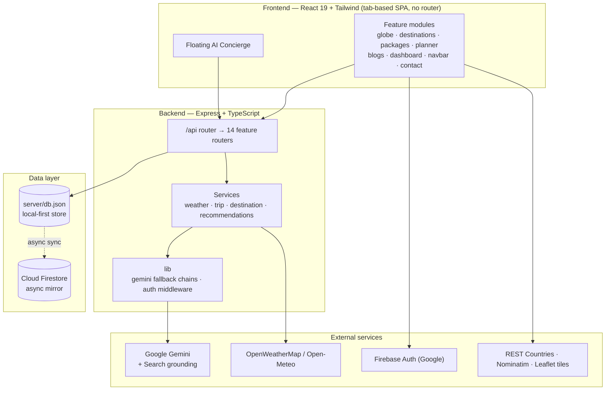

<div align="center">

# ✈️ Trippy

**A bespoke full-stack luxury travel planner — interactive 3D globe, predictive climate intelligence, and custom AI itinerary routing powered by Google Gemini.**

[](https://tripy-2.vercel.app/)
[](LICENSE)
[](https://www.typescriptlang.org/)
[](https://react.dev/)
[](https://ai.google.dev/)
[](https://tripy-2.vercel.app/)

</div>

---

## 📖 Overview

Trippy is a full-stack travel concierge that pairs a cinematic, motion-rich frontend with an Express API and Google Gemini. Plan bespoke itineraries, explore destinations on an interactive 3D globe, check live climate intelligence, read travel journals, and manage bookings from a unified workspace — all in one app.

Originally built with [Google AI Studio](https://ai.studio), the codebase has since been restructured into a modular, production-oriented architecture: a layered Express backend (routes → services → data) and feature-folder React components.

**🚀 Live: [tripy-2.vercel.app](https://tripy-2.vercel.app/)**

## ✨ Features

### 🤖 AI-Powered Planning
- **Itinerary Generator** — day-by-day plans with budget breakdowns, packing lists, visa guidance and weather intelligence (`POST /api/gemini/generate-trip`), with a model-fallback chain across Gemini models
- **Concierge Chat** — a floating luxury travel assistant with **Google Search grounding** and cited sources (`POST /api/gemini/chat`)
- **AI Destination Discovery** — search any place and Trippy creates a full destination record on the fly (`POST /api/gemini/discover-destination`)
- **AI Recommendations** — budget/duration-driven picks of 5 curated destinations (`POST /api/gemini/recommendations`)
- **Graceful degradation** — with no API key configured, every AI endpoint returns structured simulated data instead of failing

### 🌍 Interactive 3D Globe
- three.js earth with drag-to-rotate inertia, auto-rotation, glowing atmosphere and projected HTML country pins
- Country side-panel with live weather, cities, tour packages and simulated flight prices
- "Locate Me" geolocation → reverse geocoding → local weather pin
- CDN → unpkg → procedural-texture fallback chain, plus a full 2D radar UI when WebGL is unavailable

### 🗺️ Travel Catalogue
- **Destinations** — infinite auto-scrolling carousel with search, category, budget, travel-style and climate filters; favorites; live weather in the detail modal; **traveler reviews** (read + write); Leaflet map modal
- **Packages** — day-by-day itinerary timelines and instant booking with live price calculation
- **Blogs** — magazine layout with reader, mini-markdown rendering and comments

### 📊 Workspace Dashboard
- Boarding-pass styled bookings with **one-click cancellation**
- Recharts budget analytics, bookmarked locations, profile editing
- Notification bulletins with **click-to-mark-as-read**
- **Admin panel** (admin role only): booking status management, contact inbox, and create forms for destinations, packages and blogs

### 🧰 Platform
- Email/password **and** Firebase Google sign-in, session persistence with expiry detection
- Weather provider chain: OpenWeatherMap → Open-Meteo → static fallback
- Retry-with-backoff networking (`fetchWithRetry`), dark mode, motion animations, Vercel Speed Insights

## 🛠️ Tech Stack

| Layer | Technologies |
|---|---|
| **Frontend** | React 19 · TypeScript · Vite 6 · Tailwind CSS v4 · motion (Framer Motion) · three.js · recharts · lucide-react · Leaflet (CDN) |
| **Backend** | Node.js · Express 4 · TypeScript (tsx dev / esbuild prod bundle) |
| **AI** | Google Gemini (`@google/genai`) — structured output, Search grounding, model fallback |
| **Data** | Local-first JSON store (`server/db.json`) with async **Cloud Firestore** mirroring via firebase-admin |
| **Auth** | Custom bearer tokens + Firebase Authentication (Google popup) |
| **Weather** | OpenWeatherMap · Open-Meteo (keyless fallback) |
| **Deploy** | Vercel · Vercel Speed Insights |

## 🏗️ Architecture



**Key design decisions**

- **Local-first data** — every read/write hits `server/db.json` synchronously; writes are *additionally* mirrored to Firestore asynchronously. The app never blocks on (or crashes without) cloud credentials.
- **Fallback everywhere** — Gemini model chains, weather providers, globe textures and WebGL all degrade instead of failing.
- **Thin routes, fat services** — route files validate/authorize; prompts, transforms and fallbacks live in `server/services/`.

## 🚀 Quick Start

**Prerequisites:** [Node.js](https://nodejs.org) 18+ and npm.

```bash
# 1. Clone and install
git clone https://github.com/GauravPathania18/TRIPY2.git
cd TRIPY2
npm install

# 2. Configure environment
cp .env.example .env
# then edit .env and add your keys (see table below)

# 3. Run (frontend + API together on http://localhost:3000)
npm run dev
```

Open **http://localhost:3000** — the Express server also runs the Vite dev middleware, so hot reloading works out of the box.

### 🔑 Demo credentials

A seeded admin account exists for testing the admin panel:

| Field | Value |
|---|---|
| Email | `pathaniagaurav1818@gmail.com` |
| Password | `admin123` |

> ⚠️ This is **demo-only** seed data (`server/db.ts`). Do not use it in a real deployment.

## 🔐 Environment Variables

All secrets are read **server-side only** — nothing sensitive ships in the client bundle (the Firebase web config is served dynamically via `GET /api/firebase-config` with the key injected from the environment).

| Variable | Required | Purpose | Behavior if missing |
|---|---|---|---|
| `GEMINI_API_KEY` | ✅ for AI | All `/api/gemini/*` endpoints | AI returns structured **simulated** fallback data |
| `FIREBASE_API_KEY` | ✅ for Google login | Firebase client config endpoint | Google sign-in fails; email/password still works |
| `FIREBASE_SERVICE_ACCOUNT_JSON` | ⚠️ optional | firebase-admin → Firestore mirror | Runs in **local JSON mode** (data stays in `server/db.json`) |
| `OPENWEATHER_API_KEY` | ⚠️ optional | OpenWeatherMap weather | Falls back to keyless **Open-Meteo** |
| `PORT` | ⚠️ optional | HTTP port (default `3000`) | Host-injected on Vercel |
| `NODE_ENV` | ⚠️ auto | `production` switches to static `dist/` serving | Dev mode uses Vite middleware |

Copy [`.env.example`](.env.example) to `.env` for local development. **In production these live in Vercel → Project → Settings → Environment Variables** — see [docs/DEPLOYMENT.md](docs/DEPLOYMENT.md).

## 📜 Scripts

| Command | Description |
|---|---|
| `npm run dev` | Start dev server (Express + Vite HMR) on port 3000 |
| `npm run build` | Build frontend (`dist/`) + bundle backend (`dist/server.cjs`) |
| `npm start` | Run the production build |
| `npm run lint` | TypeScript type-checking (`tsc --noEmit`) |
| `npm run clean` | Remove build artifacts |

## 📂 Project Structure

```
TRIPY2/
├── server.ts                  # Thin local entrypoint: env → app → listen
├── api/
│   └── index.ts               # Vercel serverless entry: cached Express app per lambda
├── vercel.json                # Vercel wiring: build/output + /api/* rewrite to the function
├── server/
│   ├── app.ts                 # Express factory: middleware, routers, static/Vite serving
│   ├── config/env.ts          # Centralized environment access
│   ├── lib/
│   │   ├── auth.ts            # getAuthUser · requireAuth · requireAdmin
│   │   └── gemini.ts          # Gemini client + model-fallback chains
│   ├── routes/                # 14 feature routers (auth, destinations, packages,
│   │                          #  bookings, reviews, blogs, trips, favorites,
│   │                          #  contact, notifications, proxy, weather, gemini, firebase-config)
│   ├── services/              # Business logic: weather · trip · destination · recommendations
│   ├── db.ts                  # Local-first store + async Firestore mirror
│   ├── firebase-admin.ts      # Admin SDK init (env-based credentials)
│   ├── mockData.ts            # Seed destinations/packages/blogs/reviews
│   └── db.json                # Runtime data store
├── src/
│   ├── App.tsx                # Tab-based navigation root + notification drawer
│   ├── components/
│   │   ├── Navbar.tsx · Footer.tsx · Login.tsx · ChatAssistant.tsx · MapModal.tsx
│   │   ├── globe/             # 3D globe: scene hook, canvas, panel, WebGL fallback
│   │   ├── destinations/      # filters, cards, modal (+ reviews), AI discovery, recommendations
│   │   ├── packages/          # cards, itinerary modal, booking form
│   │   ├── planner/           # form, results, saved trips, generation hook
│   │   ├── blogs/             # cards, reader, comments
│   │   ├── dashboard/         # bookings, chart, favorites, bulletins, profile, admin panel
│   │   ├── navbar/            # drawer, user menu, links, auto-hide hook
│   │   ├── contact/           # contact modal
│   │   └── ui/                # shared Modal · SectionHeader
│   ├── utils/                 # api.ts (retry/backoff) · markdown.ts
│   ├── firebase.ts            # Lazy Firebase client init
│   └── types.ts               # Shared domain types
├── firestore.rules            # Firestore security rules
├── firebase-applet-config.json# Firebase client config (API key injected at runtime)
└── docs/                      # API · Deployment · Architecture references
```

## 🌐 API

The Express backend exposes **37 REST endpoints** covering auth, destinations, packages, bookings, reviews, blogs, trips, favorites, contact, notifications, weather, proxies and four Gemini AI endpoints.

Full reference — methods, auth requirements, request/response shapes and fallback behavior — see **[docs/API.md](docs/API.md)**.

## 🚢 Deployment

The app deploys to Vercel as a **single project**: Vercel's CDN serves the static frontend from `dist/`, while every `/api/*` request is rewritten by `vercel.json` to the serverless function in [`api/index.ts`](api/index.ts), which runs the shared Express app. Highlights:

1. Set the environment variables in **Vercel → Project → Settings → Environment Variables**
2. Push to `main` — `npm run build` produces `dist/` (frontend); Vercel compiles the API function
3. Without cloud credentials the app still runs (local-JSON + simulated AI modes)

Detailed guide (including Firebase/Firestore setup, verification curl checks, and the fallback matrix): **[docs/DEPLOYMENT.md](docs/DEPLOYMENT.md)**.

## 📚 Documentation

| Document | Contents |
|---|---|
| [docs/API.md](docs/API.md) | Complete endpoint reference |
| [docs/DEPLOYMENT.md](docs/DEPLOYMENT.md) | Vercel + Firebase deployment guide, env vars, fallback matrix |
| [docs/ARCHITECTURE.md](docs/ARCHITECTURE.md) | System design, data flow, auth, AI & weather chains |
| [CONTRIBUTING.md](CONTRIBUTING.md) | Development workflow and conventions |

## 🤝 Contributing

Contributions are welcome! See [CONTRIBUTING.md](CONTRIBUTING.md) for setup, coding conventions and the PR workflow.

## 📄 License

Licensed under the [MIT License](LICENSE) © 2026 Gaurav Pathania.

## 🙏 Acknowledgements

- Originally built with [Google AI Studio](https://ai.studio) — first version lives in the original **[Tripy](https://github.com/GauravPathania18/Tripy)** repository
- [Google Gemini](https://ai.google.dev/) for structured output and Search grounding
- [Three.js](https://threejs.org/), [Recharts](https://recharts.org/), [Motion](https://motion.dev/), [Leaflet](https://leafletjs.com/)
- Imagery by [Unsplash](https://unsplash.com/)

<div align="center">
<sub>Built with ❤️ by <a href="https://github.com/GauravPathania18">Gaurav Pathania</a></sub>
</div>
