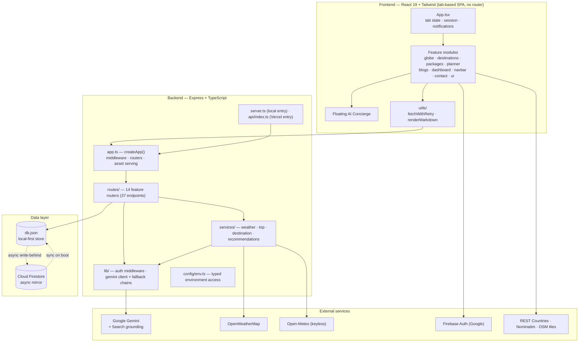

# 🏗️ Architecture — Trippy

This document describes how Trippy is structured internally: the backend layering, the frontend feature-folder system, the data/auth flows, and the build pipeline.

---

## Table of contents

- [System overview](#system-overview)
- [Repository layout](#repository-layout)
- [Backend architecture](#backend-architecture)
- [Frontend architecture](#frontend-architecture)
- [Data layer](#data-layer)
- [Authentication](#authentication)
- [AI layer](#ai-layer)
- [Build pipeline](#build-pipeline)
- [Design decisions](#design-decisions)

---

## System overview



---

## Repository layout

```
TRIPY2/
├── server.ts                  # Local entry: dotenv → createApp() → listen(PORT)
├── api/
│   └── index.ts               # Vercel serverless entry: cached createApp() per lambda
├── vercel.json                # Build/output/rewrite wiring for Vercel
├── server/
│   ├── app.ts                 # Express factory: middleware, /api mount, dev/prod assets
│   ├── config/
│   │   └── env.ts             # Typed, centralized process.env access
│   ├── lib/
│   │   ├── auth.ts            # getAuthUser · requireAuth · requireAdmin (+ Request.user typing)
│   │   └── gemini.ts          # Gemini client, generateContentWithFallback, sendChatWithFallback
│   ├── routes/                # 14 routers + index.ts (mount point)
│   │   ├── index.ts           # app.use('/api', …) aggregation
│   │   ├── auth.routes.ts     # register · login · google · me · profile
│   │   ├── destinations.routes.ts
│   │   ├── packages.routes.ts
│   │   ├── bookings.routes.ts # owner-or-admin status updates
│   │   ├── reviews.routes.ts
│   │   ├── blogs.routes.ts    # posts + comments
│   │   ├── trips.routes.ts    # saved AI itineraries
│   │   ├── favorites.routes.ts
│   │   ├── contact.routes.ts
│   │   ├── notifications.routes.ts
│   │   ├── weather.routes.ts
│   │   ├── proxy.routes.ts    # REST Countries proxy
│   │   ├── gemini.routes.ts   # 4 AI endpoints
│   │   └── firebase-config.routes.ts
│   ├── services/              # Business logic & external calls
│   │   ├── weather.service.ts         # OWM → Open-Meteo → static chain
│   │   ├── trip.service.ts            # itinerary normalization/fallback data
│   │   ├── destination.service.ts     # AI discovery → catalogue records
│   │   └── recommendations.service.ts # 5-pick recommendation payloads
│   ├── db.ts                  # Local-first store + async Firestore mirror
│   ├── firebase-admin.ts      # Admin SDK init (env-based, offline-tolerant)
│   ├── mockData.ts            # Seed catalogue (destinations, packages, blogs, reviews)
│   └── db.json                # Runtime data store (committed seed)
├── src/
│   ├── App.tsx                # Root: tab navigation, session, notification drawer
│   ├── components/
│   │   ├── Navbar.tsx · Footer.tsx · Login.tsx · ChatAssistant.tsx · MapModal.tsx …
│   │   ├── globe/             # 3D scene hook, canvas, country panel, WebGL fallback
│   │   ├── destinations/      # filters, cards, modal (+reviews), AI discovery, recommendations
│   │   ├── packages/          # cards, itinerary timeline, booking form
│   │   ├── planner/           # form, results, saved trips, generation hook
│   │   ├── blogs/             # cards, reader, comments
│   │   ├── dashboard/         # bookings, chart, favorites, bulletins, profile, admin panel
│   │   ├── navbar/            # mobile drawer, user menu, links, auto-hide hook
│   │   ├── contact/           # contact modal
│   │   └── ui/                # shared Modal · SectionHeader
│   ├── utils/
│   │   ├── api.ts             # fetchWithRetry (exponential backoff)
│   │   └── markdown.ts        # minimal markdown → React nodes
│   ├── firebase.ts            # lazy Firebase client init
│   └── types.ts               # shared domain types
├── docs/                      # API.md · DEPLOYMENT.md · ARCHITECTURE.md
├── firestore.rules            # Firestore security rules
└── firebase-applet-config.json# Firebase client config (apiKey injected at runtime)
```

---

## Backend architecture

### Request lifecycle

```
HTTP request
  → server/app.ts: cors() → express.json()
  → app.use('/api', routes/index.ts)        # feature router
      → route handler: parse + validate input
      → lib/auth.ts (when protected): resolve Bearer token → req.user
      → service function (business logic / external APIs)
      → lib/gemini.ts (AI): primary model → fallback chain → simulated data
      → db.ts (persistence): write JSON (+ async Firestore mirror)
  → response JSON (errors always { "error": string })
  → non-/api paths: dev → Vite middleware · prod → dist/ static + SPA fallback
```

### Layering rules

| Layer | Responsibility | Must not |
|---|---|---|
| `routes/*` | HTTP shape: params/body parsing, status codes, auth gates | Contain business logic or prompt text |
| `services/*` | Business rules, prompt construction, provider fallbacks, transforms | Read `req`/`res` |
| `lib/*` | Cross-cutting: auth middleware, Gemini client, fallback chains | Know about specific routes |
| `config/env.ts` | The **only** place reading `process.env` | — |
| `db.ts` | Persistence + mirror synchronization | Contain route logic |

### Endpoint inventory

37 endpoints across 14 routers — see [API.md](API.md) for the full reference.

---

## Frontend architecture

### Tab-based navigation (no router)

`App.tsx` owns a single `activeTab` string state; every page is a component switched by it. Deep-linking is handled via hash-free tab state — this keeps the bundle free of a router and matches the original design.

### Feature-folder convention

Every large page is split the same way:

```
src/components/
├── Destinations.tsx            # orchestrator (~150-200 lines): data fetching + composition
└── destinations/               # its private parts
    ├── DestinationCard.tsx     # presentational
    ├── DestinationFilters.tsx  # filter state UI
    ├── DestinationModal.tsx    # detail + weather + reviews
    ├── RecommendationsStrip.tsx# POST /api/gemini/recommendations
    ├── DiscoverAIBar.tsx       # AI discovery input
    ├── useFavorites.ts         # feature hook
    └── useInfiniteCarousel.ts  # feature hook
```

Rules:

1. **Orchestrator keeps its exact path** (`components/X.tsx`) so `App.tsx` imports never churn.
2. Subcomponents are **not exported** from the package root — they belong to the feature.
3. Shared, genuinely reusable primitives live in `components/ui/` (currently `Modal`, `SectionHeader`).
4. Feature state lives in **hooks colocated with the feature** — there is no global store; props flow down.

### Networking

- All API calls use **relative paths** (`/api/...`) — same-origin, no CORS configuration needed.
- External/flaky fetches go through `fetchWithRetry` (`utils/api.ts`): exponential backoff with console diagnostics.
- Auth headers are attached inline: `Authorization: Bearer ${user.id}:${user.role}`.

### Component inventory (post-refactor)

| Orchestrator | Feature folder | Lines (orchestrator) |
|---|---|---|
| `GlobeSection.tsx` | `globe/` (7 files) | ~120 |
| `Destinations.tsx` | `destinations/` (7 files) | ~172 |
| `AIPlanner.tsx` | `planner/` (4 files) | ~179 |
| `Packages.tsx` | `packages/` (4 files) | ~157 |
| `Blogs.tsx` | `blogs/` (4 files) | ~145 |
| `Navbar.tsx` | `navbar/` (5 files) | ~119 |
| `Dashboard.tsx` | `dashboard/` (7 files) | ~182 |
| `Footer.tsx` | `contact/` (1 file) | — |

---

## Data layer

**Local-first with write-behind mirroring:**

```
init():
  read server/db.json ──(missing/invalid)──► seed from mockData.ts
  if Firestore configured ──► syncFromFirestore() (overwrites local copy, non-fatal on failure)

mutation (any route):
  1. mutate in-memory object
  2. save() → write server/db.json   ← synchronous, authoritative
  3. if Firestore configured → queue async mirror write (never blocks the response)
```

Consequences:

- The API **never fails because of cloud credentials** — Firestore is strictly additive.
- Serverless caveat: without Firestore, `db.json` lives only for the lambda's lifetime → cold starts re-seed. This is the documented demo-mode behavior ([DEPLOYMENT.md](DEPLOYMENT.md#fallback-matrix)).

---

## Authentication

```
Email/password ── POST /api/auth/login ──► { user, token }   token = "userId:role"
Google popup ──► Firebase SDK ──► idToken verified? (client-side profile)
              └─ POST /api/auth/google ──► { user, token }   (link/lookup)

Storage: localStorage  trippy_token · trippy_user
Boot:    GET /api/auth/me with stored token → restore session / expire silently
```

- Middleware (`lib/auth.ts`): `requireAuth` resolves `req.user` or 401s; `requireAdmin` adds a role gate (403).
- **Authorization nuance:** `PUT /api/bookings/:id/status` allows *either* an admin (any status) *or* the booking's owner (cancel only) — powering the Dashboard's one-click cancel without exposing status control to users.

---

## AI layer

```
client request (optional "model" field)
  → routes/gemini.routes.ts
  → lib/gemini.ts: generateContentWithFallback / sendChatWithFallback
       try primary model (default gemini-3.5-flash)
         ├─ transient error (429/5xx/network) → next model in chain
         ├─ fatal error (400/401/403)         → stop, no retry
         └─ all exhausted                     → structured simulated payload (HTTP 200)
  → route responds with normalized JSON (+ _fallback flag where applicable)
```

- **Chat** additionally uses **Google Search grounding** and returns cited `sources[]`.
- **No `GEMINI_API_KEY`?** The chain short-circuits to simulation — the UI still renders complete trips/answers.
- Prompts and payload normalization live in `services/` (not in routes).

---

## Build pipeline

| Mode | Command | What happens |
|---|---|---|
| **Dev** | `npm run dev` | `tsx server.ts` → Express on `:3000` → Vite middleware (HMR) for all non-API routes |
| **Prod (local)** | `npm run build` → `npm start` | `vite build` → `dist/` · `esbuild server.ts` → `dist/server.cjs` (CJS, packages external) |
| **Vercel** | auto on push | Build per `vercel.json` → CDN serves `dist/` · `api/index.ts` compiled to a lambda · `/api/*` rewritten to it |

Type safety gate: `npm run lint` (`tsc --noEmit`) — must pass before every PR.

---

## Design decisions

1. **Local-first data over cloud-first** — the app boots and functions with zero cloud credentials; Firestore is a mirror, not a dependency. Rationale: demo resilience + simpler development.
2. **Fallback chains instead of error surfaces** — Gemini models, weather providers, globe textures, WebGL, and country data all degrade gracefully. A missing key changes *fidelity*, never *availability*.
3. **Feature folders with stable orchestrator paths** — full modularization without import churn in `App.tsx`; each refactored page owns an isolated folder.
4. **Thin routes, fat services** — HTTP concerns stay in routers; prompts/transforms/providers are testable units in `services/` and `lib/`.
5. **Relative API paths + same-origin hosting** — one deployment serves UI and API, eliminating CORS configuration entirely.
6. **`server.ts` kept as a thin entry** — the existing build scripts (`tsx server.ts`, esbuild bundle) and Vercel config remain valid; all real logic lives under `server/`.
